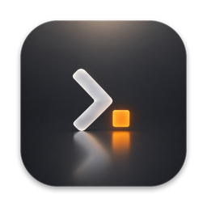
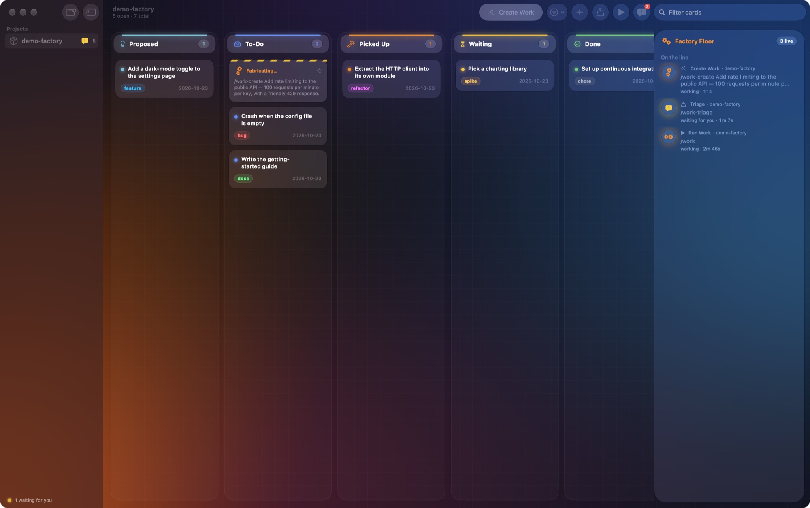
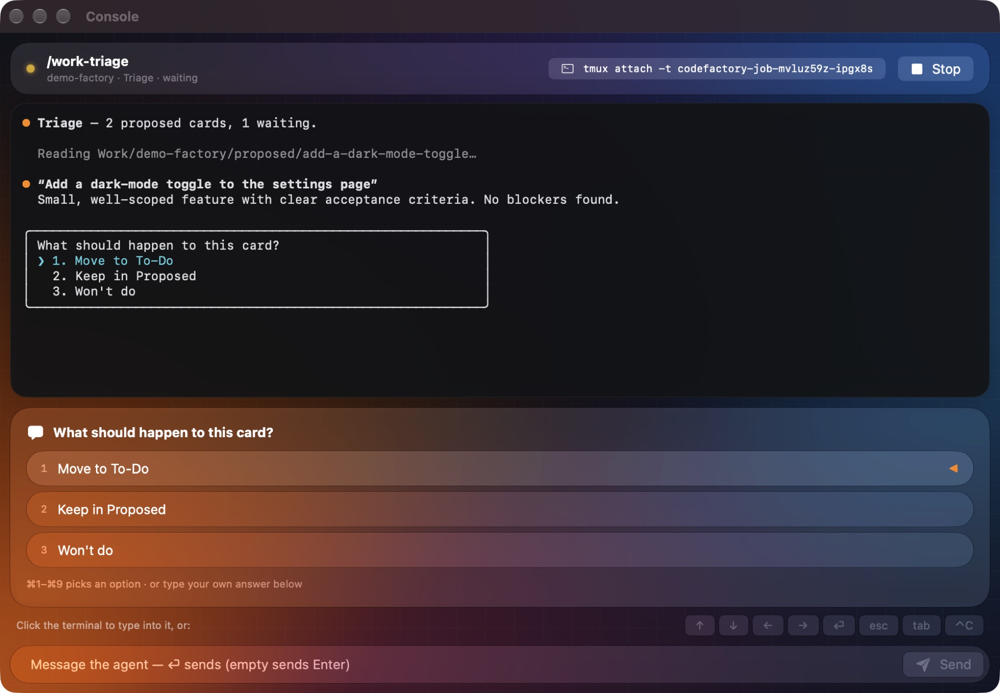
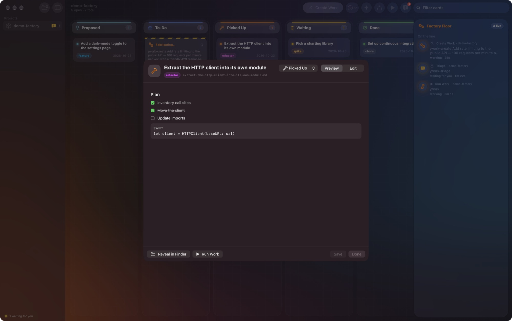

<p align="center">
  
</p>

<h1 align="center">Code Factory</h1>

<p align="center">
  <strong>Your backlog is the assembly line. Claude Code agents are the crew.</strong><br>
  A native macOS kanban board for markdown work cards, built in SwiftUI with Liquid Glass.
</p>

<p align="center">
  <a href="https://ultracodefactory.com"><strong>🌐 ultracodefactory.com</strong></a>
</p>

<p align="center">
  <a href="https://ultracodefactory.com">Website</a> ·
  <a href="#quick-start">Quick start</a> ·
  <a href="#how-it-works">How it works</a> ·
  <a href="SECURITY.md">Security</a>
</p>

<p align="center">
  <a href="https://ultracodefactory.com"></a>
  <a href="https://github.com/melucasleite/ultracodefactory/actions/workflows/ci.yml"></a>
  
  
  
  
</p>

<p align="center">
  
</p>

---

Code Factory turns a folder of plain markdown files into a production line.
Every card is a `.md` file and every column is a folder. Drag a card and the
file moves. Describe an idea and an agent writes the card. Hit **Run Work**
and an agent picks it up inside the project's repository. You watch its
terminal live, answer its questions with real buttons, and get a notification
the moment it needs you.

No database, no account, no cloud. Your cards stay plain text, so they work
just as well in Obsidian, your editor, `git` or `grep`.

## Core tenets

What Code Factory believes, and builds for.

1. **The spec is the product. Code is an implementation detail.** The
   brief, the cards and their acceptance criteria are what you own and care
   about. Code is one way of meeting them: it can be rewritten, regenerated or
   replaced, but a clear spec keeps its value.
2. **Docs first, always.** Every project starts with a `PROJECT.md`, and every
   change starts as a card that says what and why before anyone (or anything)
   writes how. If it isn't written down, it isn't ready to build.
3. **Specs live with the code.** Cards are markdown files in the repository,
   versioned in the same commits as the work they describe. No database, no
   SaaS, no lock-in: `git`, `grep` and your editor all just work.
4. **You decide, agents do.** You set direction, answer questions and review.
   Agents do the typing. The factory never merges for you.
5. **Small cards, small PRs.** A card should fit in one reviewable pull
   request. If it can't, it's two cards.
6. **Review is the job.** Your time is the scarce resource, so it goes to
   judgement (what to build, whether it's right) and not to keystrokes.
7. **Safe by default.** Agents get the least permission that works. Anything
   more is a deliberate choice you make, with the risk spelled out.

## Highlights

|                             |                                                                                                                                                                                              |
| --------------------------- | -------------------------------------------------------------------------------------------------------------------------------------------------------------------------------------------- |
| 🏭 **Live board**           | Six stations: Proposed, To-Do, Picked Up, Waiting, Done, Won't Do. Drag and drop, search, and a filter by kind. FSEvents updates the board the instant any file changes, whoever changed it. |
| 🪄 **Create Work**          | Type an idea and a headless `claude -p` agent turns it into a card. A hazard-striped _Fabricating…_ placeholder holds its spot until the card lands.                                         |
| ▶️ **Run Work & Triage**    | Interactive Claude Code sessions run in detached `tmux` sessions, one per job, inside the project's repository.                                                                              |
| 💬 **Native questions**     | When Claude asks a multiple-choice question, the console turns it into glass buttons. Click one or press ⌘1–⌘9.                                                                              |
| 🖥️ **Live consoles**        | A full-colour mirror of every agent's terminal with keyboard passthrough, ⌃C, and a one-click `tmux attach` command for your own terminal.                                                   |
| 🧭 **Factory Floor**        | A floating glass panel listing every agent's state (working, waiting for you, finished, failed) with elapsed time and Stop.                                                                  |
| 🔔 **Stays out of the way** | A menu bar status icon, plus notifications when an agent finishes or needs input.                                                                                                            |
| ✅ **Real markdown**        | Rendered cards with clickable checkboxes that write straight back to the file, and a raw editor on ⌘S.                                                                                       |
| 🧪 **Demo Factory**         | One click sets up a scratch repo with sample cards, so you can try everything without touching real code.                                                                                    |

<p align="center">
  
</p>

## The magic

Little moments that make one person feel like a crew.

- ✨ **It finishes your sentences.** In the New Project wizard, pitch the
  idea in a sentence and click **Suggest the rest from my pitch**. A quick,
  read-only Claude call pre-selects platforms, stack, features and style as
  chips you can change.
- 🏗️ **It builds the factory for you.** Finish the wizard and watch a
  checklist tick by: folder, `PROJECT.md`, git, board, then a planner agent
  that drafts your first backlog into Proposed.
- 📥 **Work arrives on its own.** Cards an agent writes drop onto the board
  with a spring and a short glow. No refresh: the board watches the disk.
- 🔀 **Review is one click away.** When a card links its pull request (the
  example `/work` skill adds it), the tile shows a **Review PR #n** chip.
- ☕ **It tells you what you missed.** Come back after a while and a glass
  banner sums it up: what shipped, what's waiting on you, and how many PRs are
  ready for review.

## Quick start

You'll need **macOS 15 or later**, [Claude Code](https://docs.claude.com/en/docs/claude-code),
and `tmux` 3.2 or later for interactive agents. Building needs Xcode 16 or
later and [XcodeGen](https://github.com/yonaskolb/XcodeGen).

```bash
brew install tmux xcodegen
git clone https://github.com/melucasleite/ultracodefactory.git
cd ultracodefactory
make run
```

`make run` generates the Xcode project, builds a Debug app and launches it.
The app is signed ad hoc, so you don't need an Apple developer account. On
first launch, click **New Project** to add a repository you already have or
start a brand-new one, or click **Try the Demo Factory**. You can also drop a
repository folder straight onto the sidebar.

| Command        | What it does                                         |
| -------------- | ---------------------------------------------------- |
| `make run`     | Build and launch                                     |
| `make test`    | Run the `CodeFactoryKit` unit tests (Swift Testing)  |
| `make project` | Generate `CodeFactory.xcodeproj` to open it in Xcode |
| `make release` | Build a Release app                                  |
| `make icon`    | Regenerate the app icon sizes from the artwork       |

## How it works

### Projects

A project is just a repository. Its cards live inside it, next to the code,
so they're versioned with everything else and agents find them right where
they work:

```
my-app/                  ← your repository; agents run here
├─ PROJECT.md            ← the brief agents read first (new projects)
└─ .codefactory/
   ├─ proposed/
   ├─ todo/
   ├─ picked-up/
   ├─ waiting/
   ├─ done/
   └─ wont-do/           ← one card per .md file
```

**New Project** asks one question first:

- **Existing project:** pick the repository. Optionally, a headless agent
  reads the code and proposes a backlog into Proposed.
- **Brand new:** a short wizard asks what you're building, which platforms
  (web, iOS, Android, Mac, Windows and Linux desktop, backend, CLI), the stack
  (pick from suggestions or let the agents choose), the features and the look.
  Code Factory creates the folder, writes `PROJECT.md`, runs `git init` and has
  an agent plan a starter backlog for you to review.

Prefer to keep cards elsewhere, such as in an Obsidian vault? Right-click a
project and choose **Keep Cards in Another Folder…**.

A card is markdown with optional flat frontmatter:

```markdown
---
title: Crash when the config file is empty
status: todo
kind: bug # feature | bug | chore | refactor | spike | docs | anything
id: 42 # optional, shown as #42
priority: high # optional
updated: 2026-10-23
---

## Acceptance criteria

- [ ] Add a failing test
- [ ] Fix the parser
```

A card's folder is its real status. When you move a card, Code Factory
rewrites only the `status:` and `updated:` lines and leaves every other byte
alone. A move never overwrites another card, and deleting a card sends it to
the Trash.

<p align="center">
  
</p>

### The agents

Each action sends the agent a slash command you can change in
**Settings → Agents**:

| Action       | Default command | Runs as                |
| ------------ | --------------- | ---------------------- |
| Create Work  | `/work-create`  | headless (`claude -p`) |
| Run Work     | `/work`         | interactive (tmux)     |
| Triage       | `/work-triage`  | interactive (tmux)     |
| Open Session | none            | interactive (tmux)     |
| Plan Backlog | built in        | headless (`claude -p`) |

Plan Backlog needs no skill: its prompt is built into the app, so a fresh
install can turn a `PROJECT.md` (or an existing codebase) into a starter
backlog on its own.

Ready-to-use versions of these skills are in
[`Examples/skills`](Examples/skills). Copy them into `~/.claude/skills/` or a
project's `.claude/skills/`. Every agent also gets `CODE_FACTORY_CARDS` (the
project's cards folder) and `CODE_FACTORY_PROJECT` in its environment, so a
skill always knows where its cards live.

### Keyboard shortcuts

| Shortcut | Action                         |
| -------- | ------------------------------ |
| ⌘N       | Create Work                    |
| ⇧⌘N      | New Card (write it yourself)   |
| ⌘R       | Run Work                       |
| ⇧⌘T      | Triage                         |
| ⇧⌘O      | Open a session in the repo     |
| ⌥⌘0      | Show or hide the Factory Floor |
| ⌘1–⌘9    | Answer an agent's question     |
| ⌘S       | Save the card you're editing   |

## Built to be safe

Code Factory launches AI agents that can change your code, so it is careful
about what it hands them. Read [SECURITY.md](SECURITY.md) for the details.

- 🛡️ **Conservative by default.** Agents start in _Accept file edits_ mode.
  _Bypass all permissions_ has to be switched on deliberately, and the app
  shows a red warning when it is.
- 🐚 **No shell, ever.** Every process starts from an argument array. Prompts
  and anything you type reach tmux as literal text, so `$(whoami)` stays text
  and "Enter" stays a word.
- 📁 **No path escapes.** Every project, column and card name is checked
  before it touches the filesystem.
- 🎯 **Precise stops.** Before signalling a process, the app confirms the PID
  still belongs to the agent it launched.
- 📡 **No telemetry.** The app makes no network connections of its own.

## Under the hood

```
App/CodeFactory/            SwiftUI app
  Support/Glass.swift       the glass design system and aurora backdrop
  Views/                    board, console, Factory Floor, sheets, settings
  Model/                    FactoryModel, ConsoleModel, preferences
Packages/CodeFactoryKit/    pure-Swift core with unit tests
  CardBoard.swift           cards on disk and path validation
  Project.swift             projects and their persistence
  ProjectBrief.swift        new-project brief, backlog planner, scaffold
  Frontmatter.swift         surgical frontmatter edits
  AgentLauncher.swift       headless and tmux agents, permission modes
  JobStore.swift            persistent job ledger and liveness checks
  QuestionParser.swift      Claude's option prompts → native buttons
  ANSI.swift                terminal colours → styled text
  DirectoryWatcher.swift    FSEvents
Examples/skills/            sample /work-create, /work and /work-triage skills
Scripts/mask-icon.swift     masks Scripts/icon-artwork.png into every app icon size
```

On macOS 26 and later the interface uses real **Liquid Glass**
(`glassEffect`, `GlassEffectContainer` and the glass button styles). On
macOS 15 it falls back to vibrant materials with a hairline rim, so the
layout is the same everywhere.

## Contributing

Pull requests are welcome. See [CONTRIBUTING.md](CONTRIBUTING.md). Tip: you
can test agent flows without spending tokens by pointing **Settings → Agents →
claude** at a small script that prints a `❯ 1. …` option list.

## License

[MIT](LICENSE) © 2026 Lucas Leite

Code Factory is an independent open-source project. It is not affiliated
with or endorsed by Anthropic. "Claude" and "Claude Code" are trademarks of
their owner.
